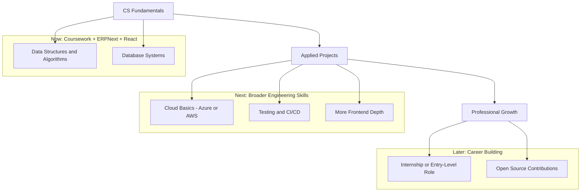

<div align="center">


<p align="center">
  
  
  
  
  
</p>

<h3>🎓 Computer Science Student • Building Systems for a Global Audience 🌐</h3>

<p>
  <a href="#about-me">About</a> •
  <a href="#tech-stack">Tech Stack</a> •
  <a href="#featured-projects">Projects</a> •
  <a href="#github-analytics">Analytics</a> •
  <a href="#recent-github-activity">Activity</a> •
  <a href="#roadmap">Roadmap</a> •
  <a href="#lets-connect">Contact</a>
</p>

---

</div>

## About Me

<div align="center">
<table>
<tr>
<td width="55%" valign="top">

```typescript
/**
 * @profile Biniyam Tehakele
 * @role    Computer Science Student
 * @base    Debre Berhan, Ethiopia (UTC+3)
 * @open_to Internships · Freelance · Remote collaboration
 */
const profile = {
  base: "Debre Berhan, Ethiopia",
  status: "Computer Science student, Debre Berhan University",
  languages: ["Amharic (native)", "English (professional working)"],
  learning: [
    "Enterprise Resource Planning (ERP)",
    "System Architecture",
    "Full-Stack Web Development",
  ],
  toolkit: [".NET Core", "Python", "React", "TypeScript"],
  goal: "Turning classroom concepts into real, working software.",
  currentlyBuilding: "ERP automation & workflow tooling",
};

function introduce(p: typeof profile): string {
  return [
    `Hi, I'm Biniyam — a ${p.status} based in ${p.base}.`,
    `I'm learning ${p.learning.join(", ")}.`,
    `Currently building: ${p.currentlyBuilding}`,
  ].join("\n");
}

console.log(introduce(profile));
```

I'm a Computer Science student at Debre Berhan University, currently
learning backend architecture (ERPNext/Frappe) and modern frontend
development (React/TypeScript) alongside my coursework. I enjoy turning
what I learn in class into real projects, and I'm open to internships,
freelance work, and remote collaboration with teams anywhere in the world.

**What I'm focused on right now:**
- Strengthening my computer science fundamentals (data structures, algorithms, databases)
- Building practical ERP automation projects to apply what I learn
- Getting comfortable with modern frontend tooling (React, TypeScript)
- Contributing to small open-source scripts and repositories

</td>
<td width="45%" align="center">

</td>
</tr>
</table>
</div>

### Quick Facts

| | |
| :--- | :--- |
| 🔭 **Currently working on** | ERPNext / Frappe automation scripts |
| 🌱 **Currently learning** | React, TypeScript, system design, cloud basics |
| 👯 **Looking to collaborate on** | Open-source Frappe/ERPNext apps and student projects |
| 🤝 **Looking for help with** | Testing strategies, CI/CD, and cloud deployment |
| 💬 **Ask me about** | ERPNext customization, Python server scripts, C# basics |
| 📫 **How to reach me** | Email or LinkedIn (links below) |
| ⚡ **Fun fact** | I like turning real business rules into working code |

---

## Tech Stack

<div align="center">

**Frontend**
<br/>


**Backend & Systems**
<br/>


**Data & Infrastructure**
<br/>


**Tools & Workflow**
<br/>


</div>

### What I'm Learning vs. What I'm Comfortable With

| Category | Technologies | Level |
| :--- | :--- | :--- |
| Backend Frameworks | ERPNext / Frappe, .NET Core, Express | Comfortable |
| Languages | Python, JavaScript, TypeScript, C# | Comfortable |
| Frontend | React, Next.js, Tailwind CSS | Learning |
| Databases | PostgreSQL, MySQL, MongoDB, Redis | Comfortable |
| DevOps | Docker, Azure, GitHub Actions | Learning |
| CS Fundamentals | Data structures, algorithms, OS, networks | Studying (coursework) |

### Badges

<div align="center">


</div>

---

## Featured Projects

<div align="center">
<table>
<tr>
<td width="50%" valign="top">

### ECX Property Automation System (PAS)

**ERPNext customization project for a commodity exchange platform.**

- Custom safety-box logic with dynamic weight/volume validation
- Enterprise-scale asset and custodian tracking
- Automated GRN/SIV document workflows
- Server-side scripting to enforce business rules

**Stack:** Frappe / ERPNext, Python, MariaDB

[](https://github.com/BinaDev29/ERPNext_Server_Script/tree/main/Stock)

</td>
<td width="50%" valign="top">

### ERPNext HR Automation

**HR management customization aligned with local labor-law rules.**

- Dynamic leave allocation (annual, sick, maternity)
- Automated severance/termination pay calculations
- Probation-expiry alerts and automated workflows
- Basic HR reporting for management review

**Stack:** Frappe / ERPNext, Python, JavaScript

[](https://github.com/BinaDev29/ERPNext_Server_Script/tree/main/HR)

</td>
</tr>
</table>
</div>

<div align="center">

**Other pinned repos:** `PNSFORALLAPP` (C#) · `SIMSS` (C#) · `BackEnd-MERNSTACK` (JavaScript) · `FullstackWEb3` (JavaScript) · `Restaurant-Order-and-Reservation-System` (PHP) · `Robot` (C#)

[](https://github.com/BinaDev29?tab=repositories)

</div>

### Live Pinned Repositories

<div align="center">

<a href="https://github.com/BinaDev29/ERPNext_Server_Script">
  
</a>
<a href="https://github.com/BinaDev29/PNSFORALLAPP">
  
</a>

<a href="https://github.com/BinaDev29/SIMSS">
  
</a>
<a href="https://github.com/BinaDev29/BackEnd-MERNSTACK">
  
</a>

</div>

> If a pin card shows blank, it is a rate limit on the free public renderer, not a problem with the repo.
> The static cards in the next section do not have this problem.

---

## GitHub Analytics

<div align="center">


<br/>


<br/><br/>


<br/><br/>


</div>

### Trophies

<div align="center">


</div>

### Profile Summary Cards

<div align="center">


</div>

---

## Recent GitHub Activity

The list below is refreshed automatically by a GitHub Action (see the setup section at the bottom).
It reads my public events from the GitHub API, so it is always real data, never hand-edited.

<!--START_SECTION:activity-->
<!--END_SECTION:activity-->

### Latest Repositories

<div align="center">

[](https://github.com/BinaDev29/ERPNext_Server_Script)

</div>

### Where My Contributions Go

| Area | Focus | Typical Tasks |
| :--- | :--- | :--- |
| ERP automation | ERPNext / Frappe | Server scripts, client scripts, custom doctypes |
| Backend | .NET Core, Node.js | REST APIs, authentication, data access |
| Frontend | React, TypeScript | Components, forms, dashboards |
| Data | MariaDB, PostgreSQL, MongoDB | Schema design, queries, migrations |
| Learning | Coursework | Algorithms, operating systems, networks |

---

## Engineering Principles

1. **Understand the business rule first.** Code follows the real process, not the other way around.
2. **Keep changes small and reviewable.** Short commits with clear messages.
3. **Validate on the server.** Client checks are for comfort; server checks are for correctness.
4. **Write it down.** A short README beats a long memory.
5. **Measure before optimizing.** Correctness first, then speed.
6. **Share what I learn.** Notes and small scripts help the next student.

```python
# A tiny example of the style I aim for: explicit, validated, readable.
import frappe
from frappe import _


def validate_safety_box(doc, method=None):
    """Reject a safety box whose contents exceed its declared capacity."""
    total_weight = sum(row.weight or 0 for row in doc.items)
    total_volume = sum(row.volume or 0 for row in doc.items)

    if total_weight > (doc.max_weight or 0):
        frappe.throw(_("Total weight {0} exceeds capacity {1}").format(
            total_weight, doc.max_weight))

    if total_volume > (doc.max_volume or 0):
        frappe.throw(_("Total volume {0} exceeds capacity {1}").format(
            total_volume, doc.max_volume))
```

---

## Roadmap



### Milestones

- [x] Build ERP automation for a commodity exchange platform
- [x] Build an HR automation module for ERPNext
- [ ] Complete core CS coursework (algorithms, OS, networks)
- [ ] Contribute to an open-source Frappe/ERPNext repository
- [ ] Complete a summer internship
- [ ] Build a personal full-stack project from scratch

### Learning Goals by Quarter

| Quarter | Goal | Evidence |
| :--- | :--- | :--- |
| Q4 2026 | Finish React + TypeScript fundamentals | A small full-stack app in a public repo |
| Q1 2027 | Add automated tests to ERPNext scripts | Test suite and a CI badge |
| Q2 2027 | Deploy a project with Docker on a cloud VM | Live demo link in the portfolio |
| Q3 2027 | Contribute a pull request to an open-source app | Merged PR |

---

## Let's Connect

<div align="center">

<p align="center">
<a href="mailto:biniyamtehakele9@gmail.com">

</a>
<a href="https://linkedin.com/in/binitehakele">

</a>
<a href="https://biniyam-flax.vercel.app/">

</a>
<a href="https://calendly.com/biniyamtehakele">

</a>
<a href="https://github.com/BinaDev29">

</a>
</p>

| Location | Timezone | Working Hours (local) | Typical Response Time |
| :--- | :--- | :--- | :--- |
| Debre Berhan, Ethiopia | UTC+3 (EAT) | 09:00–18:00 EAT | Within 12 hours |

Open to internships, freelance projects, and remote collaboration with
teams anywhere in the world — comfortable coordinating across US, EU, and
APAC time zones.

</div>

### Overlap With Your Time Zone

| Your region | Your time | My time (EAT) | Overlap |
| :--- | :--- | :--- | :--- |
| UTC / London (winter) | 07:00–15:00 | 10:00–18:00 | Excellent |
| Central Europe | 08:00–16:00 | 10:00–18:00 | Excellent |
| US East | 08:00–10:00 | 15:00–17:00 | Late afternoon |
| US West | 07:00–08:00 | 17:00–18:00 | Short window, async works well |
| India | 12:30–20:30 | 10:00–18:00 | Excellent |
| East Asia (China/Singapore) | 15:00–23:00 | 10:00–18:00 | Good |

---

## Translations

<details>
<summary><b>🇪🇹 አማርኛ (Amharic)</b></summary>

<br/>

ሰላም! እኔ ቢኒያም ተሃቀለ ነኝ፤ በደብረ ብርሃን ዩኒቨርሲቲ የኮምፒውተር ሳይንስ ተማሪ ነኝ።
ERPNext/Frappe፣ .NET Core፣ Python፣ React እና TypeScript እየተማርኩ እና እየተጠቀምኩ ነው።
ለልምምድ ሥራ፣ ለፍሪላንስ ፕሮጀክቶች እና ከዓለም ዙሪያ ካሉ ቡድኖች ጋር በርቀት ለመተባበር ዝግጁ ነኝ።

</details>

<details>
<summary><b>🇪🇸 Español (Spanish)</b></summary>

<br/>

¡Hola! Soy Biniyam Tehakele, estudiante de Ciencias de la Computación en la Universidad de Debre Berhan (Etiopía).
Estoy aprendiendo y practicando ERPNext/Frappe, .NET Core, Python, React y TypeScript.
Estoy abierto a prácticas, proyectos freelance y colaboración remota con equipos de todo el mundo.

</details>

<details>
<summary><b>🇫🇷 Français (French)</b></summary>

<br/>

Bonjour ! Je suis Biniyam Tehakele, étudiant en informatique à l'Université de Debre Berhan (Éthiopie).
J'apprends et je pratique ERPNext/Frappe, .NET Core, Python, React et TypeScript.
Je suis ouvert aux stages, aux missions freelance et à la collaboration à distance avec des équipes du monde entier.

</details>

<details>
<summary><b>🇸🇦 العربية (Arabic)</b></summary>

<br/>

<div dir="rtl">

مرحبًا! أنا بنيام تهاكلي، طالب علوم حاسوب في جامعة دبرة برهان (إثيوبيا).
أتعلّم وأمارس ERPNext/Frappe و .NET Core و Python و React و TypeScript.
أنا منفتح على التدريب والمشاريع الحرة والتعاون عن بُعد مع فرق من جميع أنحاء العالم.

</div>

</details>

<details>
<summary><b>🇨🇳 中文 (Chinese)</b></summary>

<br/>

你好！我是 Biniyam Tehakele，埃塞俄比亚德布勒伯汉大学的计算机科学专业学生。
我正在学习并实践 ERPNext/Frappe、.NET Core、Python、React 和 TypeScript。
我欢迎实习、自由职业项目，以及与世界各地团队的远程合作。

</details>

<details>
<summary><b>🇩🇪 Deutsch (German)</b></summary>

<br/>

Hallo! Ich bin Biniyam Tehakele, Informatikstudent an der Universität Debre Berhan (Äthiopien).
Ich lerne und nutze ERPNext/Frappe, .NET Core, Python, React und TypeScript.
Ich bin offen für Praktika, Freelance-Projekte und Remote-Zusammenarbeit mit Teams auf der ganzen Welt.

</details>

---

## FAQ

<details>
<summary><b>Are you available for freelance work?</b></summary>

<br/>

Yes, for small and medium projects, especially ERPNext/Frappe customization,
Python automation scripts, and simple full-stack web apps. Please email me a short
description of the goal, the deadline, and the budget range.

</details>

<details>
<summary><b>Do you work with international teams?</b></summary>

<br/>

Yes. I work in English, communicate asynchronously (issues, pull requests, short
written updates), and can join calls in the overlap windows listed above.

</details>

<details>
<summary><b>What is the best way to contact you?</b></summary>

<br/>

Email is the most reliable. LinkedIn works too. For a quick intro call, use the
Calendly link in the contact section.

</details>

<details>
<summary><b>Can I contribute to your repositories?</b></summary>

<br/>

Absolutely. Open an issue first to discuss the change, then send a pull request.
Small, focused pull requests are easiest to review.

</details>

<details>
<summary><b>Why do some stat cards look empty?</b></summary>

<br/>

Public stat services are rate limited and sometimes go offline. The cards in this
README that matter most (stats, top languages, snake, recent activity) are generated
by my own GitHub Actions and stored as static files, so they keep working.

</details>

---

## Setup Guide (for the owner of this profile)

<details>
<summary><b>⚙️ One-time setup so every card and the activity feed show real data (click to expand)</b></summary>

<br/>

The public `github-readme-stats.vercel.app` instance is no longer reliable at scale, so this
README does **not** depend on it for the important cards. Instead, three GitHub Actions
generate static files inside your own profile repository (`BinaDev29/BinaDev29`).

**Before you start**

1. The profile repository must be named exactly like your username: `BinaDev29/BinaDev29`.
2. It must be **public**.
3. Go to **Settings → Actions → General → Workflow permissions** and select
   **Read and write permissions**. Without this the workflows cannot commit files.
4. Make sure the default branch is `main`.

**1. Stats & Top Languages** — create `.github/workflows/github-stats.yml`:

```yaml
name: Update stats cards

on:
  schedule:
    - cron: "0 0 * * *"
  workflow_dispatch:

jobs:
  build:
    runs-on: ubuntu-latest
    permissions:
      contents: write
    steps:
      - uses: actions/checkout@v4

      - name: Generate stats card
        uses: stats-organization/github-readme-stats-action@v1
        with:
          card: stats
          options: "username=BinaDev29&show_icons=true&theme=tokyonight&hide_border=true&bg_color=1a1b26&include_all_commits=true&count_private=true"
          path: profile/stats.svg
          token: ${{ secrets.GH_STATS_TOKEN || secrets.GITHUB_TOKEN }}

      - name: Generate top languages card
        uses: stats-organization/github-readme-stats-action@v1
        with:
          card: top-langs
          options: "username=BinaDev29&layout=compact&langs_count=8&theme=tokyonight&hide_border=true&bg_color=1a1b26"
          path: profile/top-langs.svg
          token: ${{ secrets.GH_STATS_TOKEN || secrets.GITHUB_TOKEN }}

      - name: Commit cards
        run: |
          git config user.name "github-actions[bot]"
          git config user.email "github-actions[bot]@users.noreply.github.com"
          git add profile/*.svg
          git commit -m "chore: update stats cards" || echo "No changes to commit"
          git push
```

> The default `GITHUB_TOKEN` only sees public data. To count private contributions, create a
> [personal access token](https://github.com/settings/tokens) with `repo` and `read:user`
> scopes and save it as a repository secret named `GH_STATS_TOKEN`. If you skip this, the
> workflow still works with public data only.

**2. Contribution snake** — create `.github/workflows/snake.yml`:

```yaml
name: Generate snake animation

on:
  schedule:
    - cron: "0 0 * * *"
  workflow_dispatch:
  push:
    branches:
      - main

jobs:
  generate:
    permissions:
      contents: write
    runs-on: ubuntu-latest
    timeout-minutes: 10
    steps:
      - uses: Platane/snk/svg-only@v3
        with:
          github_user_name: BinaDev29
          outputs: |
            dist/github-contribution-grid-snake.svg
            dist/github-contribution-grid-snake-dark.svg?palette=github-dark

      - uses: crazy-max/ghaction-github-pages@v4
        with:
          target_branch: output
          build_dir: dist
        env:
          GITHUB_TOKEN: ${{ secrets.GITHUB_TOKEN }}
```

> This pushes the generated SVGs to an `output` branch, which the `` tag in the
> analytics section already points to.

**3. Recent activity feed** — create `.github/workflows/activity.yml`:

```yaml
name: Update recent activity

on:
  schedule:
    - cron: "*/30 * * * *"
  workflow_dispatch:

jobs:
  update-activity:
    runs-on: ubuntu-latest
    permissions:
      contents: write
    steps:
      - uses: actions/checkout@v4

      - uses: jamesgeorge007/github-activity-readme@master
        env:
          GITHUB_TOKEN: ${{ secrets.GITHUB_TOKEN }}
        with:
          COMMIT_MSG: "chore: update recent activity"
          MAX_LINES: 10
          TARGET_FILE: "README.md"
          EMPTY_COMMIT_MSG: "chore: refresh activity"
```

> This action looks for the two comment markers in this README:
> `<!--START_SECTION:activity-->` and `<!--END_SECTION:activity-->`.
> Keep them exactly as written, with nothing between them. The action fills that space.

**4. Optional: profile summary card** — create `.github/workflows/summary.yml`:

```yaml
name: Update profile summary card

on:
  schedule:
    - cron: "0 3 * * *"
  workflow_dispatch:

jobs:
  summary:
    runs-on: ubuntu-latest
    permissions:
      contents: write
    steps:
      - uses: actions/checkout@v4

      - name: Generate summary card
        uses: vn7n24fzkq/github-profile-summary-cards@release
        env:
          GITHUB_TOKEN: ${{ secrets.GITHUB_TOKEN }}
        with:
          USERNAME: BinaDev29
          BRANCH_NAME: main

      - name: Copy the card to the path used by this README
        run: |
          mkdir -p profile
          cp profile-summary-card-output/tokyonight/0-profile-details.svg profile/summary.svg || true
          git config user.name "github-actions[bot]"
          git config user.email "github-actions[bot]@users.noreply.github.com"
          git add profile/summary.svg
          git commit -m "chore: update summary card" || echo "No changes to commit"
          git push
```

**5. Run everything once**

1. Open the **Actions** tab of the profile repository.
2. Select each workflow in the left list.
3. Click **Run workflow** and wait for the green check mark.
4. Refresh the profile page. The cards and the activity list now show your real data.

**Troubleshooting**

| Symptom | Likely cause | Fix |
| :--- | :--- | :--- |
| Workflow fails with a 403 error on push | Workflow permissions are read-only | Settings → Actions → General → Read and write permissions |
| Stats card shows 404 | The workflow has not run yet | Run it manually from the Actions tab |
| Snake image missing | The `output` branch does not exist yet | Run the snake workflow once, then refresh |
| Activity section stays empty | Markers were edited or removed | Restore both marker comments exactly |
| Cards show old numbers | GitHub image cache | Wait a few minutes or hard refresh the page |
| Private contributions missing | Default token sees public data only | Add the `GH_STATS_TOKEN` secret |

</details>

---

## Contributing to This Profile

Spotted a typo or a broken link? Open an issue or a pull request. Translations into
more languages are welcome too: add a new collapsible block in the **Translations** section.

## Acknowledgements

- [Platane/snk](https://github.com/Platane/snk) for the contribution snake
- [github-readme-stats](https://github.com/anuraghazra/github-readme-stats) and the
  [stats-organization](https://github.com/stats-organization) action
- [streak-stats](https://github.com/DenverCoder1/github-readme-streak-stats) for streak cards
- [skillicons.dev](https://skillicons.dev) for the technology icons
- [shields.io](https://shields.io) for badges
- [capsule-render](https://github.com/kyechan99/capsule-render) for the header and footer waves
- [github-activity-readme](https://github.com/jamesgeorge007/github-activity-readme) for the activity feed

## License

The content of this README is free to reuse as a template. Please keep a link back to
the original if you copy the layout, and replace every `BinaDev29` with your own username.

---

<div align="center">

*"Still learning, still building — one project at a time."*

<br/>


</div>
